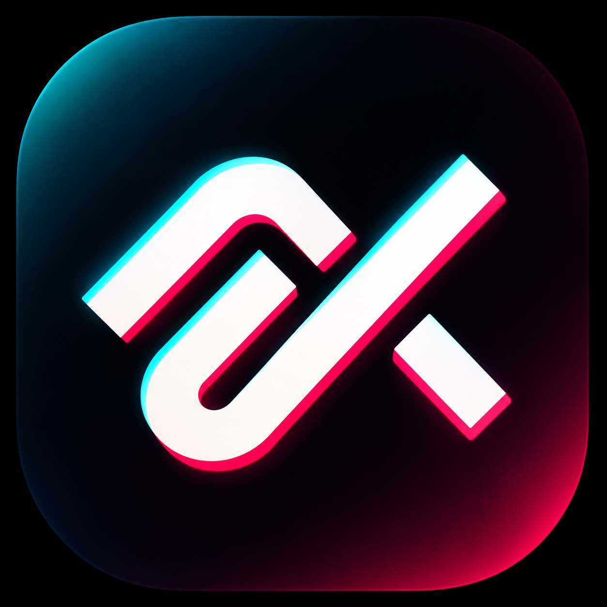

<p align="center">
  
</p>

<h1 align="center">alpha-scroll</h1>

<p align="center">An Android app for <a href="https://alphaxiv-scroll.vercel.app/">alphaXiv Scroll</a>: swipe through video explainers of papers trending on alphaXiv.</p>

<p align="center"><a href="https://github.com/saptarshihalder/alpha-scroll/raw/main/release/alphaxiv-scroll.apk"><b>Download APK (v1.1)</b></a></p>

## About

alpha-scroll wraps [alphaxiv-scroll.vercel.app](https://alphaxiv-scroll.vercel.app/) in a full-screen WebView, with no browser bar, autoplaying video, back-button navigation, and an adaptive launcher icon.

The APK is put together by a single Python script: it writes the binary manifest, the resource table, the Dalvik bytecode and the v2 signature directly, so no Android SDK or Gradle is needed.

## Build

```bash
pip install pillow cryptography
python build.py
```

The script writes `alphaxiv-scroll.apk`. On the first run it creates a signing key in `keystore/`. Keep that key: later builds need it to install over an existing copy.

## Install

Download [`alphaxiv-scroll.apk`](https://github.com/saptarshihalder/alpha-scroll/raw/main/release/alphaxiv-scroll.apk) on your phone, open it, and allow installs from that source when prompted. Requires Android 7.0 or newer.

## Credits

Content comes from [alphaXiv Scroll](https://alphaxiv-scroll.vercel.app/), built on papers from [alphaXiv](https://www.alphaxiv.org/).
